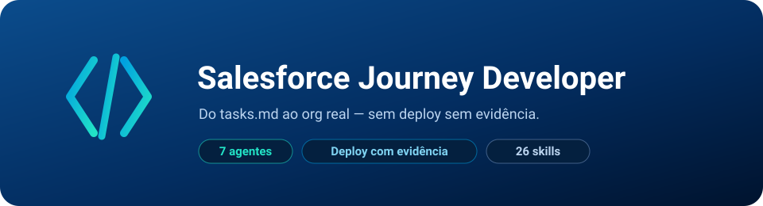

# Salesforce Journey Developer

<p align="center">

  
</p>

<p align="center">
  
  
  
</p>


Constrói e deploya de verdade o que a skill irmã **[Salesforce Journey Designer](https://github.com/brunotrolo/Salesforce_Journey_Designer)** especifica, desenha e prototipa. O Designer leva uma capacidade de ideia a `tasks.md` + `architecture.md`, validados com o negócio via protótipo LWC real; este repositório pega esse resultado e produz metadado Salesforce real — Apex, LWC de produção, Flow, configuração de Service Cloud (filas, regras, SLA, Omni-Channel, Knowledge), modelo de dados — deployado e verificado num org de verdade, nunca só "parece pronto no código-fonte".

**Instale no mesmo projeto que o Designer** — os dois compartilham `specs/`, `docs/sdd/DOMAINS.md` e `docs/sdd/BACKLOG.md`. O Designer nunca deploya nada real (seu protótipo roda com dados fictícios, localmente); este repositório é onde isso vira metadado de verdade.

**Como funciona** — mesma separação de papéis que a skill irmã Designer usa, adaptada para build/deploy:
- **Orquestração e decisão** (a sequência, o que é gap real vs. o que é ambiguidade a devolver ao Designer, o portão de evidência) → nossos **9 agentes autorais** em `.claude/agents/`. É aqui que mora o conhecimento do projeto; nada disto é importado.
- **Craft técnico** (sintaxe de campo, template de Named Credential, comando exato de deploy/teste/scan) → as **skills importadas** em `.claude/skills/`, curadas de 3 repositórios open-source (ver `.claude/skills/README.md`). Um agente **consulta** uma skill por caminho quando precisa — a skill nunca decide nada sozinha, e por isso nenhuma delas aparece como comando `/`.
- Exceções conhecidas a essa regra, documentadas nos próprios agentes: `sf-build-orchestrator` não executa skill técnica nenhuma — é puro sequenciamento (só espelha a ordem de deploy de `platform-metadata-deploy`); `sf-declarative-developer` (Dynamic Forms, Console app, utility bar) e `sf-service-config-developer` (filas, regras, SLA, Omni-Channel, Knowledge) não têm skill importada — resolvem com conhecimento de plataforma, documentação oficial consultada e memória de projeto (`memory: project`).

## Os 9 agentes

| Agente | Papel |
|---|---|
| `sf-build-orchestrator` | Ponto de entrada — lê 100% da pasta da capacidade, despacha especialistas com envelope estruturado (definido em `.claude/skills/sf-build/references/dispatch-protocol.md`), roteia cada passo pelo veredito e abordagem do `plan.md`, sequencia na ordem de dependência, nunca declara "construído" sem o gate passar. |
| `sf-data-model-developer` | Objetos/campos/RecordTypes/processo de suporte do Case/permission sets reais — **único autor de PS/PSG/CP** (padrão de nomenclatura). |
| `sf-integration-developer` | Named Credentials/External Credentials/Platform Events — plumbing de integração que todo callout/evento cross-domain depende de existir antes. |
| `sf-apex-developer` | Apex de produção + teste — nunca um sem o outro, incluindo callouts com `HttpCalloutMock`. Padrões de teste validados em builds reais inlineados (glossário em `.claude/skills/sf-build/references/recomendacoes.md`). |
| `sf-lwc-developer` | LWC de produção com dados reais e Lightning Message Service (a contraparte do protótipo do Designer). |
| `sf-service-config-developer` | Configuração Service Cloud que nenhum outro agente possui: filas, Assignment/Escalation Rules, Entitlement/Milestones, Omni-Channel, Knowledge, Macros/Quick Text. Verifica cada tipo de metadado na documentação oficial antes de escrever; o que a Metadata API não implanta vira passo manual. |
| `sf-declarative-developer` | Dynamic Forms, Highlights Panel, Compact Layout, Related Lists, quick actions, montagem da Lightning Record Page e Service Console app com utility bar — a fatia declarativa de toda capacidade. Memória de projeto para configurações sem skill. |
| `sf-automation-developer` | Flow real (Screen Flow via Flow for Service, autolaunched, record-triggered, scheduled) — a lacuna que o Designer deixa aberta de propósito. |
| `sf-deploy-gate` | Portão de evidência: scan estático → deploy validado → deploy real → teste Apex com cobertura → checagem de LWC → verificação de acesso. Relatório de falha estruturado `{phase, owning-agent, error-evidence}`. Disciplina `CHECK:`/`EXPECT:`/`ABANDON:` inlineada. |

Detalhes de cada um em [`.claude/agents/README.md`](.claude/agents/README.md). Origem e justificativa de cada skill importada em [`.claude/skills/README.md`](.claude/skills/README.md).

## Pré-requisitos

- **Salesforce CLI (`sf`) v2** instalado, e uma **org autenticada** (sandbox, scratch org, ou dev org) — `sf --version` e `sf org display --target-org <alias>` precisam funcionar antes de rodar `sf-deploy-gate`. Sem isso, o gate para e diz exatamente isso — nunca simula um deploy.
- **`@salesforce/plugin-code-analyzer` (v5.x+)** — `sf plugins install code-analyzer`. Sem ele, `sf code-analyzer run` não existe e `dx-code-analyzer-run` (usado por `sf-apex-developer` e `sf-deploy-gate`) não tem como rodar.
- **Java 11+** — motores PMD/CPD/SFGE do code analyzer dependem dele; sem Java, o scanner falha ao iniciar esses motores (mas ainda roda ESLint/RetireJS via Node).
- **Node.js ≥ 20** — Jest do `sf-lwc-developer` (o mesmo Node que o Designer já exige para o kit de protótipo) e os motores ESLint/RetireJS do code analyzer.
- **Python ≥ 3.10** e **`jq` ≥ 1.6** — dependências reais (não opcionais) de várias skills oficiais: `platform-apex-test-run`, `platform-soql-query`, `experience-lwc-security-validate`, `experience-accessibility-validate` e o motor Flow do code analyzer as usam para parsing/análise, não é um "nice to have".
- O projeto já ter o **Salesforce Journey Designer** instalado, com pelo menos uma capacidade em status "pronto para build" em `docs/sdd/BACKLOG.md` (spec + design + protótipo + plano técnico já validados).

## Como começar

### O que o Designer entrega a você

Antes de rodar `/sf-build`, verifique que a capacidade em `docs/sdd/BACKLOG.md` tem
status **"pronto para build"** — isso significa que `spec.md`, `plan.md`, `tasks.md`,
`architecture.md` e `prototype/` existem e estão validados com o negócio. A pasta
`specs/<domínio>/<NNN>-<slug>/` deve conter esses arquivos; `tasks.md` é a lista de
trabalho e `architecture.md` é o mapa de artefatos. Se `tasks.md` ou `architecture.md`
não existem, a capacidade ainda não está pronta para build — volte ao Designer.
Veja o [README do Designer](https://github.com/brunotrolo/Salesforce_Journey_Designer)
para o ciclo completo de status.

### Instalação

Rode **de dentro da pasta do projeto onde o Designer já está instalado**:

**Mac / Linux / Git Bash:**
```bash
git clone --depth 1 https://github.com/brunotrolo/Salesforce_Journey_Developer.git .jd-tmp && mkdir -p .claude && { [ -f .claude/settings.json ] && mv .claude/settings.json .claude/settings.json.anterior; :; } && cp -r .jd-tmp/.claude/. .claude/ && cp -rn .jd-tmp/force-app/. force-app/ 2>/dev/null; cp -n .jd-tmp/sfdx-project.json . 2>/dev/null; cp -n .jd-tmp/.forceignore . 2>/dev/null; rm -rf .jd-tmp
```

**Windows (PowerShell):**
```powershell
git clone --depth 1 https://github.com/brunotrolo/Salesforce_Journey_Developer.git .jd-tmp; if (-not (Test-Path .claude)) { New-Item -ItemType Directory .claude | Out-Null }; if (Test-Path .claude\settings.json) { Move-Item -Force .claude\settings.json .claude\settings.json.anterior }; Copy-Item -Recurse -Force .jd-tmp\.claude\* .claude\; if (-not (Test-Path force-app)) { Copy-Item -Recurse .jd-tmp\force-app . }; if (-not (Test-Path sfdx-project.json)) { Copy-Item .jd-tmp\sfdx-project.json . }; if (-not (Test-Path .forceignore)) { Copy-Item .jd-tmp\.forceignore . }; Remove-Item -Recurse -Force .jd-tmp
```

`-Force`/`cp -r` em `.claude/` é intencional: agentes, skills e rules daqui são um superconjunto dos do Designer — sobrescrever é um no-op para o que já existe e adiciona o resto. A cópia **não apaga** arquivos antigos: veja "Atualizando" abaixo. **Exceção: `settings.json`.** Se você já tinha um, ele é preservado como `.claude/settings.json.anterior` — permissões e hooks são configuração sua, não nossa; abra os dois e junte o que fizer sentido. `force-app/`, `sfdx-project.json` e `.forceignore` só são copiados se ainda não existirem (não sobrescreve um projeto SFDX que você já tenha).

### Atualizando de uma versão anterior

A instalação por sobreposição não remove arquivos que mudaram de nome. Se o projeto tem arquivos com o prefixo antigo `fsc-` (agentes, skills ou memória), remova-os depois de instalar — senão ficam agentes duplicados e comandos `/fsc-*` mortos.

**Mac / Linux / Git Bash:**
```bash
rm -f .claude/agents/fsc-*.md && rm -rf .claude/skills/fsc-build .claude/skills/fsc-gate .claude/agent-memory/fsc-* .claude/skills/salesforce/omnistudio-*
```
**Windows (PowerShell):**
```powershell
Remove-Item -Force .claude\agents\fsc-*.md; Remove-Item -Recurse -Force .claude\skills\fsc-build, .claude\skills\fsc-gate, .claude\agent-memory\fsc-*, .claude\skills\salesforce\omnistudio-*
```

As variáveis de ambiente também mudaram: use `SF_TARGET_ORG`, `SF_HEAVY_TESTS_APPROVED` e `SF_FINALIZE_DOCS`. As antigas deixam de ter efeito (o hook fica fail-closed até `SF_TARGET_ORG` ser definida).

### Configuração obrigatória: `SF_TARGET_ORG`

Antes de qualquer deploy, defina o alias da **sandbox** deste projeto:

```bash
export SF_TARGET_ORG=minha-sandbox        # Mac / Linux / Git Bash
```
```powershell
$env:SF_TARGET_ORG = "minha-sandbox"      # Windows (PowerShell)
```

Nenhum alias vem embutido no repositório, de propósito: um clone não pode herdar a org de
outra pessoa. O `guard-deploy.mjs` é **fail-closed** — enquanto a variável não estiver
definida, todo `sf project deploy start` e `sf apex run test` é bloqueado, e depois de
definida só esse alias passa. Coloque o `export` no seu shell profile para não repetir a
cada sessão.

Depois, abra o Claude Code na pasta do projeto — os agentes, as rules e os comandos `/` carregam automaticamente junto com os do Designer.

## O que entra no seu `.claude/`

| Caminho | O que faz | Quando carrega |
|---|---|---|
| `agents/` | Os subagentes. Cada um roda na própria janela de contexto. | Quando despachados |
| `rules/` | `journey-developer.md` (regras estruturais sempre válidas + contract de report dos especialistas) e `karpathy-guidelines.md` (disciplina comportamental: pense antes de codar, simplicidade, mudanças cirúrgicas, execução orientada a objetivo — contextualizada para build/deploy real), ambas sem `paths:` + `apex.md`, `lwc.md`, `metadata.md`, escopadas por `paths:`. | As duas primeiras no início da sessão; as outras só quando um arquivo que casa o glob entra em contexto |
| `skills/sf-build/`, `skills/sf-gate/` | Os comandos `/sf-build` e `/sf-gate`. | Sob demanda, quando você digita |
| `skills/salesforce/`, `agent-skills/`, `mattpocock/` | As skills importadas. Ficam sob uma pasta de categoria, então **não são invocáveis por `/`** — são documentos de referência que os agentes leem por caminho, de propósito (carregar todas no menu poluiria sem ajudar). | Quando um agente lê o `SKILL.md` que precisa |
| `settings.json` + `hooks/` | Permissões (o que roda sem perguntar, o que é negado) e o guard de deploy. | Aplicados em toda chamada de ferramenta |
| `agent-memory/` | Memória persistente de `sf-declarative-developer` e `sf-service-config-developer` (fatos verificados sobre configurações sem skill importada — criada na primeira vez que o agente confirma algo). | Início de cada execução daquele agente |
| `skills/apex-test-loop/` *(condicional)* | Clonado sozinho pelo `sf-deploy-gate` só quando um deploy falha por cobertura de Apex insuficiente (org Enterprise exige ≥75%) — ver `.claude/skills/README.md`. Não existe num clone limpo. | Quando o gate detecta esse tipo específico de falha |

### Comandos

| Comando | O que faz |
|---|---|
| `/sf-build <domínio> <capacidade>` | Constrói e deploya uma capacidade inteira via `sf-build-orchestrator`, com o portão obrigatório no fim. Sem args, lista domínios/capacidades do BACKLOG.md. |
| `/sf-gate <domínio> <capacidade>` | Só re-roda o portão de evidência contra algo já construído: está mesmo deployado, testado e passando? |
| `/sf-status` | Mostra onde cada capacidade está no pipeline SDD — o que está especificado, prototipado, pronto para build, e o que está bloqueado. |

### O que o `settings.json` impede na prática

Permissões cobrem o óbvio (`sf org delete`, `sf data delete`, `rm -rf`, `git push --force`, leitura de `.env`/`*.key` negados; comandos `sf` de leitura e os testes pré-aprovados). O hook `.claude/skills/sf-build/scripts/guard-deploy.mjs` cobre os casos que **derrotariam o portão de evidência em silêncio, ou fugiriam do escopo exato pedido** — e por isso são bloqueio, não prosa:

- `--ignore-errors`/`--ignore-warnings` num deploy (esconde falha real);
- deploy com teste (`--test-level` diferente de `NoTestRun`) sem `SF_HEAVY_TESTS_APPROVED=1` (pula a aprovação explícita do modo pesado);
- `--source-dir force-app` inteiro (reacopla os domínios, que são fronteiras de deploy independentes);
- `--source-dir` em deploy de ciclo rápido (`--test-level NoTestRun`) — esse modo é sempre `--metadata <Tipo>:<Nome>`, nunca pasta inteira (ver "Deploying an artifact" em `.claude/rules/journey-developer.md`);
- `sf org delete` / `sf data delete`;
- deploy/teste sem `--target-org`, ou apontado para uma org diferente de `$SF_TARGET_ORG` (ver Instalação).

Comandos de mutação real (`sf project deploy start` sem `--dry-run`, `sf data create record`, `sf org assign permset`) disparam prompt de permissão — são checkpoints humanos na mutação do org, não falhas. Leitura, dry-run, scans e testes são pré-aprovados.

Um segundo hook, `.claude/skills/sf-build/scripts/guard-test-content.mjs` (`Write|Edit`), pede confirmação quando uma classe de teste Apex (`*Test.cls`/`*_tst.cls`) consulta por `Name`/`DeveloperName` um objeto de configuração da org (RecordType, Profile, Queue…) ou chama método estático de outra classe de teste — testes precisam ser autocontidos para não quebrar o deploy em outro ambiente.

Está em Node porque Node ≥20 já é pré-requisito e se comporta igual no Windows, Mac e Linux — um hook `.sh` não. Se o payload vier quebrado, ele sai em silêncio sem bloquear: um bug no guard nunca pode travar trabalho legítimo.

## Como o orquestrador funciona internamente

### Dispatch envelope e propriedade de metadado

O envelope `{capability-path, metadata-root, relevant-tasks, relevant-objects, change-class}` — nunca só "leia architecture.md" — e a tabela de **um dono por tipo de metadado** estão em [`.claude/skills/sf-build/references/dispatch-protocol.md`](.claude/skills/sf-build/references/dispatch-protocol.md), fonte única. Cada passo do `plan.md` é roteado pelo próprio veredito (padrão/customizado) e abordagem; capacidade `misto` roteia passo a passo.

### Report contract dos especialistas

Todo especialista devolve um relatório estruturado com seções padronizadas:

```markdown
## Files Touched
- force-app/domains/<domain>/main/default/classes/MyClass.cls
- ...

## Gaps Found
- [NEEDS CLARIFICATION] architecture.md não especifica o tipo do campo X
- ...

## Decisions Made
- Standard object <SObject> cobre o caso de uso; custom object rejeitado porque...
- ...
```

O orquestrador lê `## Gaps Found` para decidir se routa ao usuário (gap bloqueante) ou continua (gap não-bloqueante registrado). Isso evita que sinais importantes se percam em prosa livre.

### Pipeline status e recuperação

Após cada especialista completar, o orquestrador appenda uma linha de status no `build-report.md`:

```markdown
## Pipeline Status
- [x] data-model: done (3 objects, 2 fields, 1 PS)
- [x] integration: done (2 Named Credentials, 1 Platform Event)
- [ ] apex: pending
```

Se a sessão for interrompida no meio, é possível retomar de onde parou.

### Iteration cap

Se o mesmo especialista falhar no deploy-gate 3 vezes para o mesmo artifact, o orquestrador para e escala ao usuário com o build-report para intervenção manual — nunca loop infinito.

### Failure routing

Quando o gate falha, ele produz um relatório estruturado:

```
{
  phase: "2-validate-deploy",
  failing-artifact: "MyService.cls",
  owning-agent: "sf-apex-developer",
  error-evidence: "Compile error: Method does not exist: AccountService.getById()",
  suggested-fix: "Verificar se sf-data-model-developer criou o campo ExtId__c"
}
```

O orquestrador usa `owning-agent` para re-invocar o especialista correto. Falhas de infraestrutura (auth, conexão) roteiam ao usuário — o especialista não falhou, o ambiente falhou.

## Ciclo por capacidade

```
specs/<domínio>/<NNN>-<slug>/ inteira    (produzida pelo Designer, já validada com o negócio)
        ↓
sf-build-orchestrator: lê 100%, valida status, monta dispatch envelope
        ↓
(A) modelo de dados + integração → (B) Apex + configuração Service Cloud → (C) LWC + Flow → (D) declarativo
        ↓                                              (cada um com report contract)
sf-deploy-gate: scan → manifest check → validar → deploy → testar → verificar acesso
        ↓                                              (failure report estruturado)
docs/sdd/BACKLOG.md atualizado + build-report.md com pipeline status
```

Uma capacidade só é dada como "construída" quando `sf-deploy-gate` reporta cada fase com evidência executável (job id do deploy, id da execução de teste, cobertura real, contagem de findings de scan) — nunca por um agente declarar "deveria funcionar" sem rodar o comando que prova isso.

## Sobre as skills importadas — resumo

Vêm de [`forcedotcom/sf-skills`](https://github.com/forcedotcom/sf-skills) (oficiais da Salesforce, Apache-2.0) — as que o Designer já usa para prototipar, mais as específicas de build/deploy real (teste Apex, deploy via `sf`, scan estático, permission set, Flow, SOQL, modelo de dados, segurança/acessibilidade de LWC, integração/Named Credential/Platform Event, montagem de Lightning Record Page) — e de dois repositórios de disciplina de engenharia que também inspiraram este projeto, [`addyosmani/agent-skills`](https://github.com/addyosmani/agent-skills) e [`mattpocock/skills`](https://github.com/mattpocock/skills). Nenhum deles é específico de Salesforce, então só o subconjunto que reforça um pipeline de deploy real foi curado (a disciplina de evidência `CHECK:`/`EXPECT:`/`ABANDON:`, herdada do `unlazy`, vive inlineada em prosa no `sf-deploy-gate`, sem diretório vendored). A lista exata, skill por skill, está em [`.claude/skills/README.md`](.claude/skills/README.md).

---

## 📋 Resumo — input, o que faz, o que entrega

| | |
|---|---|
| **Input** | A pasta `specs/<domínio>/<NNN>-<slug>/` **inteira**, já produzida pelo Designer, com status pelo menos "pronto para build" em `docs/sdd/BACKLOG.md` — `spec.md`, `plan.md`, `tasks.md`, `architecture.md`, `prototype/`. `sf-build-orchestrator` lê essa pasta 100%, não só `tasks.md`/`architecture.md`. |
| **O que faz** | Despacha os especialistas com envelope estruturado, em ordem de dependência — (A) `sf-data-model-developer` + `sf-integration-developer` → (B) `sf-apex-developer` + `sf-service-config-developer` → (C) `sf-lwc-developer` + `sf-automation-developer` → (D) `sf-declarative-developer` — cada um com report contract padronizado. Por fim roda `sf-deploy-gate`, obrigatório: scan estático → manifest completeness → deploy validado → deploy real → teste Apex com cobertura → checagem de LWC (Jest/segurança/acessibilidade) → verificação de acesso → relatório pós-deploy. Cada fase exige evidência executável (comando, exit code, campo do JSON); falhas produzem relatório estruturado `{phase, owning-agent, error-evidence}`. |
| **Entrega** | Metadado Salesforce real em `force-app/domains/<domínio>/main/default/` **deployado e verificado num org de verdade** — objetos/campos/permission sets, Apex + teste, LWC de produção, Flow, configuração Service Cloud (filas, regras, Entitlement, Omni-Channel, Knowledge), Named Credential/Platform Event, montagem de página e Service Console. Mais `specs/<domínio>/<NNN>-<slug>/build-report.md` (evidência + pipeline status) e `docs/sdd/BACKLOG.md` atualizado para "construído e deployado". |

---

<p align="center">
  ⭐ <b><a href="https://github.com/brunotrolo/Salesforce_Journey_Developer/stargazers">Dê uma star no repo</a></b> para ser avisado quando novas skills e melhorias saírem.
</p>
